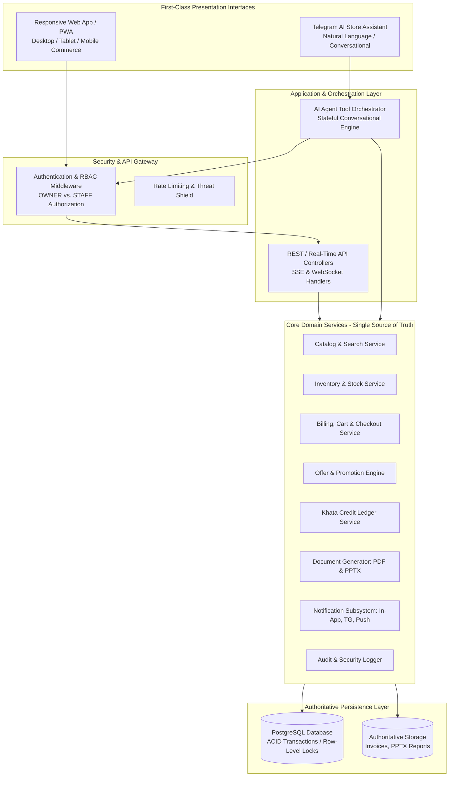
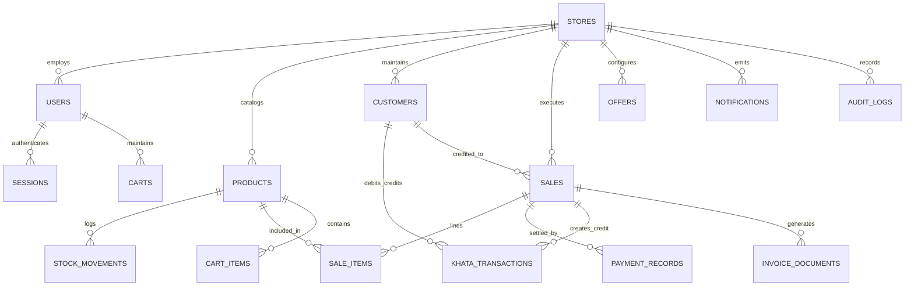
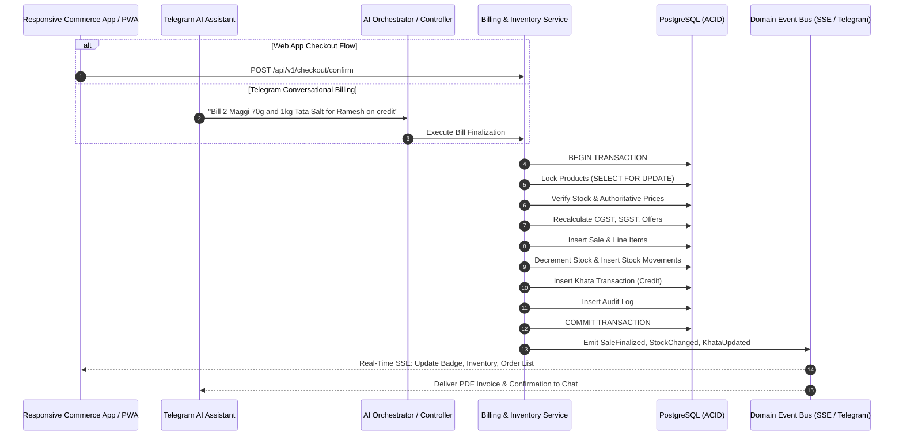
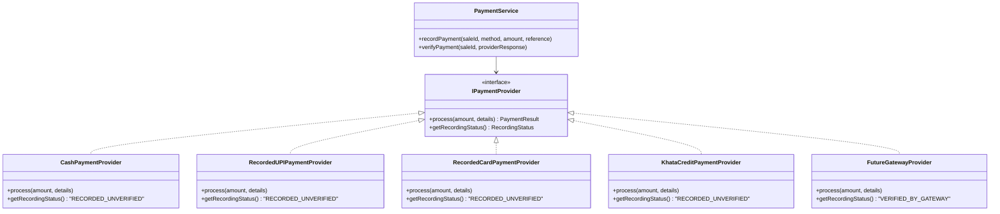
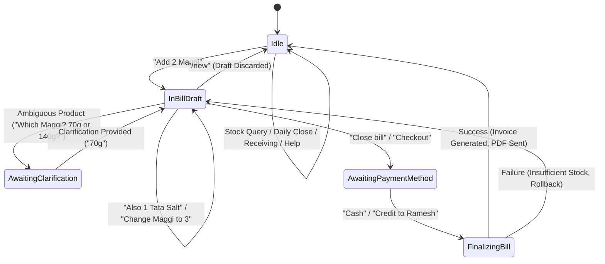

# NEBULA SUPERMARKET PLATFORM
## Unified Master Architecture & Engineering Specification
### Dual-Interface AI Store Operations & Modern Commerce Platform (Telegram AI Assistant + Responsive PWA)

---

## 1. Executive Vision & System Invariants

### 1.1 Product Vision
The **Nebula Supermarket Platform** is a dual-interface supermarket operations and commerce management platform engineered to deliver:
1. **A Conversational Telegram AI Store Assistant** that enables supermarket store owners and staff to manage stock, execute multi-turn billing, maintain customer khata (credit ledgers), generate GST invoices, trigger low-stock alerts, run daily store reconciliations, and produce weekly analytical presentations using natural language.
2. **A Responsive Modern Commerce Web App / PWA** providing an original, highly polished commerce interface (desktop, tablet, and mobile) inspired by the usability, visual clarity, and responsiveness of premier commerce platforms (e.g., Amazon, Flipkart) without replicating any proprietary branding, logos, or copyrighted visual assets.

Both user experiences are built on a single, shared backend source of truth. No business logic, validation rules, stock arithmetic, tax formulas, or ledger calculations are duplicated across interfaces.



### 1.2 Core System Invariants (Truth-in-Data Axioms)
Every component in the system must strictly adhere to the following non-negotiable principles:
* **Zero Fabrication Axiom**: Never fabricate, estimate, or simulate operational data. If no sales occurred today, the system displays `No sales recorded today.` and never generates synthetic sales numbers, fake reviews, mock ratings, or invented inventory counts.
* **Payment Recording Honesty**: Real payment gateway verification (Razorpay, Stripe, UPI Intent) is only reported if a cryptographic gateway signature/webhook is verified. When a store clerk receives Cash, UPI, Card, or Khata credit, the system explicitly records and displays: `Payment method recorded.` (e.g., `Recorded UPI Payment: Reference #982137`), never claiming third-party external gateway verification when none was performed.
* **Backend Authority**: Frontend clients (Web and Telegram) are strictly presentation surfaces. The backend alone recalculates prices, evaluates active promotional rules, computes CGST/SGST/IGST, reserves row locks, and enforces oversell guards. Clients cannot dictate discounts or final totals.
* **Atomic Financial Transactions**: Checkouts, stock adjustments, and khata settlements execute within ACID database transactions with row-level locking (`SELECT ... FOR UPDATE`). Any failure (stock depletion, concurrent update, invalid customer) triggers an immediate, total rollback.
* **Auditable Reversals**: Sales and inventory updates are never deleted. Any return, cancellation, or correction generates an auditable reversal record tied to the original transaction ID.

---

## 2. Shared Domain Model & Database Schema

The database is built on PostgreSQL to provide relational integrity, ACID compliance, and concurrency control.



### 2.1 Core Entities & Fields

#### Store (`stores`)
* `id` (UUID, PK)
* `name` (VARCHAR(150), NOT NULL)
* `legal_name` (VARCHAR(200))
* `gstin` (VARCHAR(15), NULLABLE) - Standard 15-character Indian GSTIN
* `address_line1` (VARCHAR(255), NOT NULL)
* `address_line2` (VARCHAR(255))
* `city` (VARCHAR(100), NOT NULL)
* `state` (VARCHAR(100), NOT NULL)
* `pincode` (VARCHAR(10), NOT NULL)
* `phone` (VARCHAR(20), NOT NULL)
* `email` (VARCHAR(100))
* `currency` (VARCHAR(5), DEFAULT 'INR')
* `invoice_prefix` (VARCHAR(10), DEFAULT 'INV-')
* `invoice_counter` (BIGINT, DEFAULT 1000)
* `daily_close_time` (TIME, DEFAULT '21:00:00')
* `created_at`, `updated_at` (TIMESTAMPTZ)

#### User & Authentication (`users`, `user_sessions`)
* `users.id` (UUID, PK)
* `users.store_id` (UUID, FK -> stores.id)
* `users.username` (VARCHAR(50), UNIQUE)
* `users.email` (VARCHAR(150), UNIQUE)
* `users.phone` (VARCHAR(20), NULLABLE)
* `users.password_hash` (TEXT, NOT NULL) - Argon2id or bcrypt (cost factor 12)
* `users.role` (ENUM: `OWNER`, `STAFF`)
* `users.telegram_user_id` (BIGINT, UNIQUE, NULLABLE) - Linked Telegram ID for bot operations
* `users.is_active` (BOOLEAN, DEFAULT TRUE)
* `user_sessions.id` (UUID, PK)
* `user_sessions.user_id` (UUID, FK -> users.id)
* `user_sessions.session_token_hash` (VARCHAR(128), UNIQUE)
* `user_sessions.user_agent` (TEXT)
* `user_sessions.ip_address` (VARCHAR(45))
* `user_sessions.created_at`, `user_sessions.last_activity_at`, `user_sessions.expires_at` (TIMESTAMPTZ)

#### Product Catalog & Stock (`products`, `stock_movements`)
* `products.id` (UUID, PK)
* `products.store_id` (UUID, FK -> stores.id)
* `products.sku` (VARCHAR(50), NOT NULL)
* `products.barcode` (VARCHAR(50), NULLABLE)
* `products.name` (VARCHAR(200), NOT NULL)
* `products.brand` (VARCHAR(100), NOT NULL)
* `products.category` (VARCHAR(100), NOT NULL)
* `products.description` (TEXT)
* `products.image_url` (TEXT, NULLABLE) - Only populated if a genuine image exists; no placeholder fake art
* `products.unit` (VARCHAR(20), NOT NULL) - e.g., 'packet', 'kg', 'g', 'litre', 'bottle', 'piece'
* `products.pack_size` (VARCHAR(50), NOT NULL) - e.g., '70g', '5kg', '500ml', 'Pack of 4'
* `products.cost_price` (NUMERIC(12,2), NOT NULL) - Confidential to OWNER; masked from STAFF
* `products.mrp` (NUMERIC(12,2), NOT NULL) - Maximum Retail Price printed on packaging
* `products.selling_price` (NUMERIC(12,2), NOT NULL) - Actual store selling price (<= MRP)
* `products.gst_rate` (NUMERIC(5,2), NOT NULL) - 0.00, 5.00, 12.00, 18.00, 28.00
* `products.hsn_code` (VARCHAR(12), NOT NULL) - Harmonized System of Nomenclature code
* `products.stock_quantity` (NUMERIC(12,3), NOT NULL, DEFAULT 0.000)
* `products.reorder_level` (NUMERIC(12,3), NOT NULL, DEFAULT 10.000)
* `products.is_active` (BOOLEAN, DEFAULT TRUE)
* `products.created_at`, `products.updated_at` (TIMESTAMPTZ)
* `stock_movements.id` (UUID, PK)
* `stock_movements.product_id` (UUID, FK -> products.id)
* `stock_movements.movement_type` (ENUM: `RECEIPT`, `SALE`, `SALE_RETURN`, `AUDIT_ADJUSTMENT`, `WASTAGE`)
* `stock_movements.quantity_delta` (NUMERIC(12,3), NOT NULL)
* `stock_movements.previous_stock` (NUMERIC(12,3), NOT NULL)
* `stock_movements.resulting_stock` (NUMERIC(12,3), NOT NULL)
* `stock_movements.unit_cost_price` (NUMERIC(12,2), NULLABLE)
* `stock_movements.reference_id` (UUID, NULLABLE) - Linked Sale ID, Receipt PO ID, or Adjustment ID
* `stock_movements.performed_by` (UUID, FK -> users.id)
* `stock_movements.created_at` (TIMESTAMPTZ)

#### Customer & Khata Credit Ledger (`customers`, `khata_transactions`)
* `customers.id` (UUID, PK)
* `customers.store_id` (UUID, FK -> stores.id)
* `customers.name` (VARCHAR(150), NOT NULL)
* `customers.phone` (VARCHAR(20), NOT NULL)
* `customers.address` (TEXT, NULLABLE)
* `customers.credit_limit` (NUMERIC(12,2), DEFAULT 5000.00)
* `customers.current_balance` (NUMERIC(12,2), DEFAULT 0.00) - Positive indicates money owed to store
* `customers.created_at`, `customers.updated_at` (TIMESTAMPTZ)
* `khata_transactions.id` (UUID, PK)
* `khata_transactions.customer_id` (UUID, FK -> customers.id)
* `khata_transactions.store_id` (UUID, FK -> stores.id)
* `khata_transactions.transaction_type` (ENUM: `CREDIT_SALE`, `PAYMENT_RECEIVED`, `ADJUSTMENT`)
* `khata_transactions.amount` (NUMERIC(12,2), NOT NULL)
* `khata_transactions.balance_before` (NUMERIC(12,2), NOT NULL)
* `khata_transactions.balance_after` (NUMERIC(12,2), NOT NULL)
* `khata_transactions.reference_sale_id` (UUID, NULLABLE, FK -> sales.id)
* `khata_transactions.payment_method` (ENUM: `CASH`, `UPI`, `BANK_TRANSFER`, NULLABLE)
* `khata_transactions.notes` (TEXT)
* `khata_transactions.recorded_by` (UUID, FK -> users.id)
* `khata_transactions.created_at` (TIMESTAMPTZ)

#### Offers & Promotions (`offers`)
* `offers.id` (UUID, PK)
* `offers.store_id` (UUID, FK -> stores.id)
* `offers.name` (VARCHAR(150), NOT NULL) - e.g., 'Amul Butter 10% Off'
* `offers.description` (TEXT)
* `offers.offer_type` (ENUM: `PERCENTAGE`, `FIXED_AMOUNT`, `BUY_X_GET_Y`, `CART_DISCOUNT`)
* `offers.discount_value` (NUMERIC(10,2), NOT NULL)
* `offers.minimum_quantity` (NUMERIC(10,2), DEFAULT 1.00)
* `offers.minimum_cart_value` (NUMERIC(12,2), DEFAULT 0.00)
* `offers.buy_quantity` (INTEGER, NULLABLE)
* `offers.get_quantity` (INTEGER, NULLABLE)
* `offers.applicable_product_ids` (UUID[], NULLABLE)
* `offers.applicable_categories` (VARCHAR(100)[], NULLABLE)
* `offers.start_at` (TIMESTAMPTZ, NOT NULL)
* `offers.end_at` (TIMESTAMPTZ, NOT NULL)
* `offers.is_active` (BOOLEAN, DEFAULT TRUE)
* `offers.created_at`, `offers.updated_at` (TIMESTAMPTZ)

#### Cart & Draft Billings (`carts`, `cart_items`)
* `carts.id` (UUID, PK)
* `carts.store_id` (UUID, FK -> stores.id)
* `carts.user_id` (UUID, FK -> users.id)
* `carts.channel` (ENUM: `WEB_APP`, `TELEGRAM`)
* `carts.customer_id` (UUID, NULLABLE, FK -> customers.id)
* `carts.status` (ENUM: `ACTIVE`, `FINALIZED`, `ABANDONED`)
* `carts.created_at`, `carts.updated_at` (TIMESTAMPTZ)
* `cart_items.id` (UUID, PK)
* `cart_items.cart_id` (UUID, FK -> carts.id ON DELETE CASCADE)
* `cart_items.product_id` (UUID, FK -> products.id)
* `cart_items.quantity` (NUMERIC(12,3), NOT NULL)
* `cart_items.added_at` (TIMESTAMPTZ)

#### Sales, Orders & Line Items (`sales`, `sale_items`, `payment_records`)
* `sales.id` (UUID, PK)
* `sales.store_id` (UUID, FK -> stores.id)
* `sales.invoice_number` (VARCHAR(50), UNIQUE, NOT NULL) - e.g., 'INV-2026-0042'
* `sales.customer_id` (UUID, NULLABLE, FK -> customers.id)
* `sales.created_by` (UUID, FK -> users.id)
* `sales.channel` (ENUM: `WEB_APP`, `TELEGRAM`)
* `sales.subtotal` (NUMERIC(12,2), NOT NULL)
* `sales.discount_total` (NUMERIC(12,2), NOT NULL, DEFAULT 0.00)
* `sales.taxable_amount` (NUMERIC(12,2), NOT NULL)
* `sales.cgst_amount` (NUMERIC(12,2), NOT NULL, DEFAULT 0.00)
* `sales.sgst_amount` (NUMERIC(12,2), NOT NULL, DEFAULT 0.00)
* `sales.igst_amount` (NUMERIC(12,2), NOT NULL, DEFAULT 0.00)
* `sales.total_tax` (NUMERIC(12,2), NOT NULL)
* `sales.grand_total` (NUMERIC(12,2), NOT NULL)
* `sales.status` (ENUM: `DRAFT`, `PENDING_CONFIRMATION`, `CONFIRMED`, `PAID_RECORDED`, `COMPLETED`, `CANCELLED`)
* `sales.pdf_invoice_path` (TEXT, NULLABLE)
* `sales.created_at` (TIMESTAMPTZ)
* `sale_items.id` (UUID, PK)
* `sale_items.sale_id` (UUID, FK -> sales.id ON DELETE CASCADE)
* `sale_items.product_id` (UUID, FK -> products.id)
* `sale_items.product_name` (VARCHAR(200), NOT NULL)
* `sale_items.hsn_code` (VARCHAR(12), NOT NULL)
* `sale_items.quantity` (NUMERIC(12,3), NOT NULL)
* `sale_items.unit_mrp` (NUMERIC(12,2), NOT NULL)
* `sale_items.unit_selling_price` (NUMERIC(12,2), NOT NULL)
* `sale_items.discount_amount` (NUMERIC(12,2), DEFAULT 0.00)
* `sale_items.taxable_value` (NUMERIC(12,2), NOT NULL)
* `sale_items.gst_rate` (NUMERIC(5,2), NOT NULL)
* `sale_items.cgst_amount` (NUMERIC(12,2), NOT NULL)
* `sale_items.sgst_amount` (NUMERIC(12,2), NOT NULL)
* `sale_items.total_amount` (NUMERIC(12,2), NOT NULL)
* `payment_records.id` (UUID, PK)
* `payment_records.sale_id` (UUID, FK -> sales.id)
* `payment_records.payment_method` (ENUM: `CASH`, `UPI`, `CARD`, `CREDIT`)
* `payment_records.amount` (NUMERIC(12,2), NOT NULL)
* `payment_records.recording_status` (ENUM: `RECORDED_UNVERIFIED`, `VERIFIED_BY_GATEWAY`) - DEFAULT `RECORDED_UNVERIFIED`
* `payment_records.payment_reference` (VARCHAR(100), NULLABLE) - e.g., UPI Transaction Reference / Card Auth Code
* `payment_records.notes` (TEXT, NULLABLE)
* `payment_records.recorded_at` (TIMESTAMPTZ)

#### Notifications & Preferences (`notifications`, `notification_preferences`)
* `notifications.id` (UUID, PK)
* `notifications.store_id` (UUID, FK -> stores.id)
* `notifications.user_id` (UUID, NULLABLE, FK -> users.id) - NULL indicates store-wide broadcast
* `notifications.category` (ENUM: `INVENTORY`, `LOW_STOCK`, `SALE`, `PAYMENT`, `KHATA`, `OFFER`, `SYSTEM`, `SECURITY`, `REPORT`, `DOCUMENT`)
* `notifications.title` (VARCHAR(200), NOT NULL)
* `notifications.message` (TEXT, NOT NULL)
* `notifications.severity` (ENUM: `INFO`, `SUCCESS`, `WARNING`, `CRITICAL`)
* `notifications.related_resource_type` (VARCHAR(50), NULLABLE) - e.g., 'product', 'sale', 'customer'
* `notifications.related_resource_id` (UUID, NULLABLE)
* `notifications.is_read` (BOOLEAN, DEFAULT FALSE)
* `notifications.created_at` (TIMESTAMPTZ)
* `notification_preferences.store_id` (UUID, FK -> stores.id, PK)
* `notification_preferences.low_stock_alerts` (BOOLEAN, DEFAULT TRUE)
* `notification_preferences.daily_sales_summary` (BOOLEAN, DEFAULT TRUE)
* `notification_preferences.daily_sales_summary_time` (TIME, DEFAULT '21:00:00')
* `notification_preferences.khata_payment_alerts` (BOOLEAN, DEFAULT TRUE)
* `notification_preferences.weekly_report_alerts` (BOOLEAN, DEFAULT TRUE)
* `notification_preferences.telegram_alerts_enabled` (BOOLEAN, DEFAULT TRUE)
* `notification_preferences.browser_push_enabled` (BOOLEAN, DEFAULT FALSE)

#### Immutable Audit Trail (`audit_logs`)
* `audit_logs.id` (UUID, PK)
* `audit_logs.store_id` (UUID, FK -> stores.id)
* `audit_logs.user_id` (UUID, NULLABLE, FK -> users.id)
* `audit_logs.action` (VARCHAR(100), NOT NULL) - e.g., `CHECKOUT_FINALIZED`, `STOCK_RECEIVED`, `KHATA_CREDIT_ISSUED`, `OFFER_CREATED`, `STORE_SETTINGS_MODIFIED`, `LOGIN_ATTEMPT`
* `audit_logs.entity_type` (VARCHAR(50), NOT NULL)
* `audit_logs.entity_id` (VARCHAR(50), NOT NULL)
* `audit_logs.ip_address` (VARCHAR(45), NULLABLE)
* `audit_logs.user_agent` (TEXT, NULLABLE)
* `audit_logs.old_values` (JSONB, NULLABLE)
* `audit_logs.new_values` (JSONB, NULLABLE)
* `audit_logs.created_at` (TIMESTAMPTZ, NOT NULL)

---

## 3. Two First-Class Interfaces Architecture

Both user interfaces invoke the exact same backend services via a shared domain layer.



### 3.1 Interface 1: Telegram AI Store Assistant
* **Mandatory Operational Scenarios**:
  1. **Stock Receiving**: Parsing natural language delivery notes (e.g., `"Received 50 packets of Maggi 70g at ₹12 cost"`), updating inventory, calculating average cost, logging stock movements.
  2. **New Product Creation**: Adding uncatalogued goods with SKU, name, unit, MRP, selling price, GST rate, HSN, reorder level.
  3. **Stock Query**: Real-time inventory queries (`"How many packets of Maggi left?"`, `"List items below reorder level"`).
  4. **Multi-Turn Conversational Billing**: Stateful conversational drafting (`"Add 2 Maggi"`, `"Also 1 Tata Salt"`, `"Change Maggi to 3"`, `"Remove Tata Salt"`, `/new` to reset).
  5. **Ambiguity Clarification**: When user queries are ambiguous (e.g., `"Add 2 Maggi"` when 70g and 140g exist), the AI pauses and asks for clarification before modifying the draft.
  6. **Oversell Guard**: Strictly rejects adding or finalizing items that exceed available on-hand stock (`"Cannot add 12 packets: only 5 in stock"`).
  7. **Khata Ledger**: Adding balance to customer account (`"Put ₹450 bill on Ramesh's khata"`), checking balance (`"How much does Ramesh owe?"`), recording repayment (`"Ramesh paid ₹300 via UPI"`).
  8. **Daily Store Close**: Day-end reconciliation reporting total sales, breakdown by cash, UPI, card, and khata credit, cash reconciliation, and low-stock warnings.
  9. **PDF Invoice Dispatch**: Direct delivery of formatted PDF tax invoice to the Telegram chat immediately upon sale finalization.
  10. **PPTX Weekly Presentation Dispatch**: Direct generation and delivery of executive PowerPoint decks (`weekly_sales_report.pptx`) summarizing sales trends, top categories, and inventory health.
  11. **Persistent Preferences**: Configuration via chat (`"Notify me when stock drops below 15"`).
  12. **`/new` Command**: Cleanses active conversation draft bill state cleanly without touching committed transactions.

### 3.2 Interface 2: Responsive Commerce Web App / PWA
* **Visual Polish & Ergonomics**:
  * Designed with modern commerce principles: intuitive layout, high-density product cards, crisp typography, accessible touch targets, and fluid transitions.
  * Completely original visual identity: zero imitation of Amazon or Flipkart proprietary assets, icons, logos, or color themes.
  * Desktop / Tablet Layout: Collapsible operational sidebar, global search bar with instant autocomplete, notifications tray, sticky cart summary drawer.
  * Mobile Layout: Bottom navigation bar (`Home`, `Products`, `Cart`, `Orders`, `More`), touch-optimized swipe actions, bottom sheet modals for quick filter and customer selection.
* **Core Screens & Capabilities**:
  1. **Home / Operations Dashboard**: Real-time KPIs (Today's Sales, Orders Count, Low-Stock Count, Khata Outstanding), Recent Orders stream, Quick Stock Receipts, Popular Products, Active Store Offers. Strict empty states when zero sales recorded.
  2. **Product Catalog & Category Discovery**: Filter by category, brand, stock status, tax bracket; grid and table views; batch operations.
  3. **Product Details View**: High-resolution image if genuinely available (fallback clean SVG glyph), MRP, Selling Price, Savings indicator, GST/HSN badge, Real-time Stock indicator, Quantity stepper, Add-to-Cart. Restricted Cost Price section visible only to OWNER.
  4. **Persistent Cart**: Session-backed cart, quantity adjustments, tax preview, offer discount preview. Does NOT decrement stock until checkout finalization.
  5. **6-Step Checkout Flow**:
     * Step 1: Review Cart Items
     * Step 2: Customer / Khata Selection
     * Step 3: Payment Method Selection (`CASH`, `UPI`, `CARD`, `CREDIT / KHATA`)
     * Step 4: Authoritative Order Review (Subtotal, Tax Breakdown CGST/SGST, Applied Offers, Total)
     * Step 5: Explicit Final Confirmation
     * Step 6: Transaction Receipt & Invoice Actions (View, PDF Download, Telegram Send)
  6. **Customer & Khata Ledger**: Customer list, credit limits, transaction timeline, Record Repayment dialog, statement download.
  7. **Orders & Invoices**: Paginated historical invoices, status badges, print-ready PDF renderer, re-send to Telegram action.
  8. **Notification Center**: Tabbed notifications (`All`, `Unread`, `Inventory`, `Khata`, `Security`), mark-as-read, real-time unread badge.
  9. **Store & Security Settings**: Store profile, GSTIN configuration, session revocation, login history, password change.
  10. **PWA Capabilities**: Web App Manifest (`manifest.json`), service worker for static asset caching, offline fallback detection (disabling financial writes when disconnected).

---

## 4. End-to-End Core Commerce Experience

### 4.1 Product Search Engine Specification
The search engine must deliver instant, relevant results without guessing or fabricating matches:
* **Token Normalization**: Strip punctuation, lowercase text, normalize whitespace, handle Hindi/English transliterations where standard (`atta` -> `Wheat Flour / Atta`).
* **Multi-Field Matching**:
  * Exact SKU or Barcode match (Weight: 100)
  * Exact Product Name match (Weight: 80)
  * Partial Prefix Name / Brand match (Weight: 50)
  * Category match (Weight: 30)
* **Typo Tolerance**: Levenshtein distance <= 1 for terms > 4 chars; Levenshtein <= 2 for terms > 7 chars.
* **Ambiguity Handling**: If the query matches multiple products with equal relevance, return all matches in the search UI or list options in Telegram. Never guess which product the user meant.

### 4.2 Product Details & Visibility Rules
* **Customer/Staff View**:
  * Product Name, Brand, Category, Pack Size
  * Real MRP, Selling Price, Genuine Discount/Savings
  * Stock Status (`In Stock`, `Low Stock: X remaining`, `Out of Stock`)
  * GST Rate & HSN Code
  * Active Configured Offers
* **Owner View Only**:
  * Cost Price (Purchasing price)
  * Gross Margin Percentage: `((Selling Price - Cost Price) / Selling Price) * 100`
  * Supplier / Stock Receipt History

### 4.3 Persistent Cart System
* The Web App cart belongs to the authenticated store session.
* Updating quantities in the cart performs client-side optimistic calculation for display, but flags a pending server re-validation.
* Cart items do **not** lock or decrement inventory. Inventory remains available to other shoppers/staff until checkout step 5 (Confirm).

---

## 5. Checkout, Payments & Transactional Integrity

### 5.1 Authoritative Cart Validation
Before the checkout process can finalize, the backend executes a comprehensive re-validation:
1. Product existence and `is_active = TRUE` check.
2. Price freshness verification (ensuring product selling prices have not changed since item was placed in cart).
3. On-hand stock verification: `stock_quantity >= cart_quantity`.
4. Active offer validation (checking start/end timestamps, minimum cart value, eligible category/product rules).
5. Tax calculation: Authoritative re-computation of CGST and SGST at the line-item level.

### 5.2 Honest Payment Engine Architecture
To comply with hiring task guidelines, the payment subsystem implements a modular abstraction that separates payment recording from external payment gateway verification.



* **Honesty Rule**:
  * When Cash, Recorded UPI, Recorded Card, or Khata is chosen, the UI and API explicitly return:
    `"payment_status": "RECORDED_UNVERIFIED"`
    `"message": "UPI payment method recorded. Reference #123456."`
  * The UI badge displays `RECORDED` with an info tooltip: `Transaction recorded by store operator; not verified through external payment gateway.`
  * The system never displays `Payment verified by Razorpay/Stripe` unless genuine gateway credentials are provided and a verified webhook payload has been parsed.

### 5.3 The 16-Step Atomic Checkout Transaction
Every checkout finalization executes inside an isolated ACID database transaction:

```sql
-- 16-Step Atomic Finalization Pseudo-Flow
BEGIN TRANSACTION ISOLATION LEVEL READ COMMITTED;

-- Step 1: Authenticate session and resolve user
-- Step 2: Validate store context (store_id)
-- Step 3: Validate Cart (items exist, valid quantities)

-- Step 4: Lock Inventory Rows to eliminate race conditions
SELECT id, name, selling_price, gst_rate, hsn_code, stock_quantity, reorder_level 
FROM products 
WHERE id IN (:product_ids) AND store_id = :store_id 
FOR UPDATE;

-- Step 5: Re-check available stock under row lock
-- IF stock_quantity < cart_quantity THEN ROLLBACK; RAISE InsufficientStockException;

-- Step 6: Read authoritative locked prices
-- Step 7: Calculate Line Item GST (CGST, SGST, IGST)
-- Step 8: Calculate Valid Offers & Deduct Discounts
-- Step 9: Validate Payment Method & Details

-- Step 10: Insert Master Sale Record
INSERT INTO sales (id, store_id, invoice_number, customer_id, created_by, channel, subtotal, discount_total, taxable_amount, cgst_amount, sgst_amount, total_tax, grand_total, status)
VALUES (...);

-- Step 11: Insert Line Items
INSERT INTO sale_items (sale_id, product_id, product_name, hsn_code, quantity, unit_mrp, unit_selling_price, discount_amount, taxable_value, gst_rate, cgst_amount, sgst_amount, total_amount)
VALUES (...);

-- Step 12: Decrement Product Stock
UPDATE products 
SET stock_quantity = stock_quantity - :quantity, updated_at = NOW() 
WHERE id = :product_id;

-- Step 13: Create Stock Movements for Audit Trail
INSERT INTO stock_movements (product_id, movement_type, quantity_delta, previous_stock, resulting_stock, reference_id, performed_by)
VALUES (...);

-- Step 14: If Payment is CREDIT, Create Khata Transaction & Update Customer Balance
-- UPDATE customers SET current_balance = current_balance + :grand_total WHERE id = :customer_id;
-- INSERT INTO khata_transactions (...);

-- Step 15: Create Audit Event
INSERT INTO audit_logs (store_id, user_id, action, entity_type, entity_id, new_values)
VALUES (...);

-- Step 16: Commit Transaction
COMMIT;
```
If any step fails or an exception is thrown, the entire operation is rolled back, releasing all locks without mutating balances or stock.

---

## 6. Real-Time Event Architecture & Notification Subsystem

### 6.1 Internal Domain Event Bus
The application implements an in-process, asynchronous Domain Event Bus adhering to the modular monolith pattern:

```mermaid
graph LR
    subgraph Trigger [Operational Triggers]
        S1[Stock Receipt Finalized]
        S2[Sale Checkout Committed]
        S3[Khata Repayment Added]
        S4[Security Alert Triggered]
    end

    subgraph EventBus [Internal Domain Event Dispatcher]
        E1[StockReceivedEvent]
        E2[SaleFinalizedEvent]
        E3[KhataUpdatedEvent]
        E4[SecurityAlertEvent]
    end

    subgraph Listeners [Event Listeners]
        L1[Inventory Threshold Checker]
        L2[Notification Persister]
        L3[SSE Web App Broadcaster]
        L4[Telegram Alert Notifier]
        L5[Document Generator PDF/PPTX]
    end

    Trigger --> EventBus
    EventBus --> Listeners
```



### 6.2 Event Definitions & Handlers
* **`SaleFinalizedEvent`**:
  * Emitted after checkout commit.
  * Triggers:
    1. Inventory recalculation check for low stock.
    2. Generation of GST Tax Invoice PDF.
    3. Broadcast over SSE to Web App clients to refresh Today's Sales counters and Activity Feed.
    4. If sale was created via Telegram, dispatches PDF invoice to user's Telegram chat.
* **`StockReceivedEvent`**:
  * Emitted after new inventory delivery is saved.
  * Triggers:
    1. Stock count updates in real-time UI via SSE.
    2. Clears low-stock warning flag if stock exceeds reorder level.
    3. Logs activity feed entry (`Received 50 Maggi 70g`).
* **`LowStockDetectedEvent`**:
  * Emitted when `resulting_stock <= reorder_level` and `previous_stock > reorder_level` (threshold event, preventing duplicate spam).
  * Triggers:
    1. Persistent Notification entry (`category = 'LOW_STOCK'`).
    2. Real-time push to Web App Notification Center.
    3. Telegram notification to Store Owner: `⚠️ Tata Salt is low on stock: 4 packets remaining.`

### 6.3 Notification Center UX
* **Categories**: `All`, `Unread`, `Inventory`, `Orders`, `Payments`, `Khata`, `Security`.
* **Actions**: `Mark as Read`, `Mark All as Read`, `View Related Entity` (deep-linking to Product, Order, or Khata).
* **Audit Persistence**: Marking notifications as read never deletes the underlying security or audit log entries.

---

## 7. Telegram AI Store Assistant Specification

### 7.1 Conversational State Machine
The Telegram Assistant operates as a stateful agent with memory of the current active session.



### 7.2 AI Agent Tools Contract
The AI Agent communicates with the domain services exclusively via strict tool signatures:

1. `tool_search_products(query: string, limit: int)`
   * Returns matching products with SKU, name, pack size, selling price, and stock.
2. `tool_draft_bill_add_item(user_id: string, product_id: string, quantity: float)`
   * Validates stock; adds or updates quantity in the user's active draft bill.
3. `tool_draft_bill_remove_item(user_id: string, product_id: string)`
   * Removes item from draft bill.
4. `tool_draft_bill_get(user_id: string)`
   * Returns current draft items, subtotal, tax breakdown, and estimated total.
5. `tool_draft_bill_clear(user_id: string)`
   * Resets active draft bill without executing financial transaction (`/new`).
6. `tool_finalize_sale(user_id: string, payment_method: string, customer_id: string, payment_ref: string)`
   * Executes the 16-step atomic checkout transaction. Returns sale ID, invoice number, and PDF file path.
7. `tool_receive_stock(product_id: string, quantity: float, cost_price: float, supplier_ref: string)`
   * Records inventory increment, updates cost price, logs stock movement.
8. `tool_create_product(name: string, brand: string, category: string, pack_size: string, unit: string, mrp: float, selling_price: float, cost_price: float, gst_rate: float, hsn_code: string, reorder_level: float)`
   * Adds new product to store catalog.
9. `tool_khata_record_payment(customer_id: string, amount: float, payment_method: string, notes: string)`
   * Deducts customer outstanding balance and records khata transaction.
10. `tool_khata_query_balance(customer_name_or_phone: string)`
    * Looks up customer and returns current outstanding credit balance.
11. `tool_get_daily_close_summary(store_id: string, date: string)`
    * Generates comprehensive day-end closing report (sales total, payment breakdowns, tax collected, cash in drawer).
12. `tool_generate_weekly_presentation(store_id: string)`
    * Compiles sales metrics and generates `.pptx` PowerPoint deck.

---

## 8. Document Generation Subsystem

### 8.1 GST Tax Invoice Generator (PDF)
* Built using high-performance vector rendering (`PDFKit` / `reportlab`).
* Generated immediately upon sale finalization and stored at:
  `/storage/invoices/{store_id}/{year}/{invoice_number}.pdf`
* Required Tax Elements (Indian GST Compliance):
  * Store Legal Name, Address, Phone, GSTIN.
  * Invoice Number (Sequential, e.g., `INV-2026-0042`) & Timestamp.
  * Customer Name, Phone, and Khata Reference (if applicable).
  * Table of Items: S.No, Item Description, HSN Code, Quantity, Unit, MRP, Rate, Taxable Value, CGST Rate & Amount, SGST Rate & Amount, Total.
  * Summary: Total Taxable Value, Total CGST, Total SGST, Grand Total (in Numbers and Words).
  * Payment Status Stamp: `RECORDED: CASH` / `RECORDED: UPI` / `CREDIT (KHATA)`.
  * Standard Legal Disclaimer: `"This is a computer-generated tax invoice."`

### 8.2 Weekly Executive Presentation Generator (PPTX)
* Generates an executive-ready `.pptx` presentation deck (`python-pptx`).
* **Slide 1**: Title Slide — Store Name, Weekly Performance Review, Date Range.
* **Slide 2**: Executive Summary — Total Revenue, Total Bills Generated, Average Bill Value, Net Margin.
* **Slide 3**: Category Performance — Revenue and volume breakdown by department (Groceries, Dairy, Snacks, Personal Care).
* **Slide 4**: Fast-Moving Products — Top 5 items by revenue and velocity.
* **Slide 5**: Khata Health & Receivables — Total outstanding credit, collection efficiency, top pending customer accounts.
* **Slide 6**: Inventory Health & Reorder Recommendations — Low-stock alerts, out-of-stock items, capital required for replenishment.

---

## 9. Web App Responsive Design System & UX Standards

### 9.1 Professional Commerce Visual Architecture
* **Color Palette**:
  * Primary / Trust: Deep Slate Blue (`#0F172A`, `#1E293B`, `#3B82F6`)
  * Surface / Background: Clean Neutral Gray (`#F8FAFC`, `#FFFFFF`, `#F1F5F9`)
  * Accents / Operational:
    * Success / In-Stock / Paid: Emerald (`#10B981`)
    * Warning / Low Stock: Amber (`#F59E0B`)
    * Critical / Out of Stock / Rollback: Rose / Crimson (`#EF4444`)
* **Typography**: Clean, readable sans-serif font family (`Inter`, `system-ui`) with clear numerical tabular figures (`font-variant-numeric: tabular-nums`) for currency and quantities.
* **Accessibility (a11y)**:
  * Full keyboard accessibility: tab order, `Escape` to close modals, `Enter` to confirm.
  * WCAG AA contrast ratio compliance across all text and interactive buttons.
  * Proper ARIA labels on icon buttons, cart badges, and live alert feeds.
  * Touch targets >= 44x44px for mobile views.

### 9.2 Navigation Structure
* **Desktop (`>= 1024px`)**:
  * Left Collapsible Sidebar: `Dashboard`, `Catalog`, `Billing / POS`, `Orders`, `Khata`, `Offers`, `Inventory`, `Reports`, `Settings`.
  * Top Bar: Global Search Bar, Store Switcher (if multi-store), Notification Bell (with unread count badge), Active User Profile pill.
* **Mobile (`< 1024px`)**:
  * Top Header: Store Name, Search Icon, Notification Bell.
  * Bottom Fixed Bar: `Home`, `Catalog`, `Cart` (with dynamic item count badge), `Orders`, `More` (Khata, Reports, Settings).

---

## 10. Security, RBAC & Data Protection

### 10.1 Role-Based Access Control (RBAC) Matrix

| Resource / Action | Store OWNER | Store STAFF | Unauthenticated |
| :--- | :---: | :---: | :---: |
| View Catalog & Selling Prices | Allowed | Allowed | Denied |
| View Product Cost Prices & Margins | **Allowed** | **DENIED (Masked)** | Denied |
| Add / Update Product Catalog | Allowed | Denied | Denied |
| Draft Cart & Create Bills | Allowed | Allowed | Denied |
| Finalize Sale (Cash/UPI/Card) | Allowed | Allowed | Denied |
| Issue Khata Credit (Within Limit) | Allowed | Allowed | Denied |
| Modify Customer Credit Limits | **Allowed** | **Denied** | Denied |
| View Financial Analytics & Margin | **Allowed** | **Denied** | Denied |
| Generate Day-End Close Report | Allowed | Allowed (Operational) | Denied |
| Access PPTX Weekly Deck | **Allowed** | **Denied** | Denied |
| Modify Store Profile & GSTIN | **Allowed** | **Denied** | Denied |
| Manage Staff Accounts & Passwords | **Allowed** | **Denied** | Denied |
| View Active Sessions & Revoke | Allowed | Allowed (Own session) | Denied |

* **Security Rule**: UI elements for forbidden actions are hidden, but backend middleware strictly verifies JWT/session role claims on every endpoint. Any unauthorized attempt returns `403 Forbidden` and logs a security audit event.

### 10.2 Account Security & Session Management
* Dedicated Account Security page displays:
  * Current active session (IP, Browser/OS user-agent, last active timestamp).
  * List of all active sessions across devices.
  * Action: `Logout All Other Devices` (invalidates session tokens in `user_sessions`).
  * Password Change form requiring verification of current password.
  * Real-time security alerts: `New login detected from Windows Chrome`.

---

## 11. PWA & Offline Resilience Strategy

### 11.1 Progressive Web App Manifest
* Web manifest (`manifest.json`) providing app icons (192x192, 512x512), standalone display mode, background color, and theme color.
* Service Worker installs caching strategy:
  * Static Assets (HTML, CSS, JS, Fonts): **Cache-First**, updating in background.
  * Read-Only Catalog & Past Invoices: **Stale-While-Revalidate**.
  * Financial Mutations (Checkout, Stock Receipt, Khata Payment): **Network-Only**.

### 11.2 Offline Financial Barrier
* If internet connection drops:
  * The Web App UI displays a prominent banner: `Offline — Financial actions (checkout, payments, stock changes) are disabled.`
  * The checkout button is disabled with tooltip: `Network connection required for authoritative inventory check.`
  * Under no circumstances may an offline client finalize a bill or claim payment success.

---

## 12. Verification & Acceptance Criteria Matrix

| Domain / Feature | Verification Criteria | Pass / Fail Rule |
| :--- | :--- | :--- |
| **Dual Interface** | Same product added via Telegram or Web reflects identical database record and stock decrement. | Any mismatch in prices, taxes, or stock = **FAIL** |
| **Zero Mock Data** | On zero sales day, UI displays `No sales recorded today.` No fake stats anywhere. | Any synthetic number = **FAIL** |
| **Oversell Guard** | Attempting to sell quantity > on-hand stock aborts with humanized error in both Telegram & App. | Any negative inventory count = **FAIL** |
| **Payment Honesty** | Transactions recorded via Cash/UPI/Card/Credit explicitly state `Recorded`, not `Verified by Gateway`. | Claiming external gateway verification without API = **FAIL** |
| **Atomic Checkout** | If database connection fails during checkout step 12, all stock decrements and invoice lines are rolled back. | Any partial record created = **FAIL** |
| **GST Calculation** | CGST and SGST correctly computed at 50% of GST rate per item. Tax invoices match Indian GST rules. | Any math or tax mismatch = **FAIL** |
| **Khata Ledger** | Credit checkout increments customer balance; repayment decrements balance; history is audit-logged. | Balance mismatch = **FAIL** |
| **Daily Close** | Generates accurate breakdown of Cash, UPI, Card, and Credit sales matching individual invoice records. | Discrepancy with actual sales sum = **FAIL** |
| **Document Engine** | PDF tax invoice generated with correct GSTIN and items; PPTX weekly report renders formatted slides. | Broken PDF or corrupted PPTX = **FAIL** |
| **Role-Based Security** | STAFF account cannot view product cost prices, gross margins, or store GST settings. | Cost price leaked in API response = **FAIL** |
| **Session Control** | Logging out or revoking sessions from Security page immediately terminates target session access. | Expired/revoked token accepted = **FAIL** |
| **Telegram Commands** | `/new` clears draft; natural language queries handle ambiguous products by asking for clarification. | AI guessing or unhandled error = **FAIL** |

---

## 13. Project Implementation Roadmap

1. **Phase 1: Database Schema & Modular Monolith Core**
   * Setup PostgreSQL tables, indexes, constraints, and audit log triggers.
   * Implement repository and domain services (Catalog, Inventory, Billing, Khata, Offers).
   * Implement 16-step atomic checkout transaction with row-level locking.
2. **Phase 2: Telegram AI Store Assistant**
   * Integrate Telegram Bot API with NLP/AI agent orchestrator.
   * Implement all 12 operational tool functions.
   * Implement stateful draft billing, ambiguity clarification, and `/new` command.
3. **Phase 3: Responsive Commerce Web App / PWA**
   * Build React/Vite responsive commerce frontend with TailwindCSS.
   * Implement Home Dashboard, Catalog Search, Product Details, Cart, and 6-Step Checkout.
   * Implement Khata management, Orders history, and Security settings screens.
4. **Phase 4: Document Generation & Real-Time Events**
   * Implement PDF Tax Invoice generation engine and PPTX presentation compiler.
   * Implement Server-Sent Events (SSE) bus for real-time stock and notification broadcasts.
5. **Phase 5: Quality Assurance, Security Audit & Acceptance Testing**
   * Execute concurrency tests on stock locking under simultaneous checkouts.
   * Verify zero mock data invariants and honest payment status reporting.
   * Validate full responsive layout across mobile, tablet, and desktop viewports.
